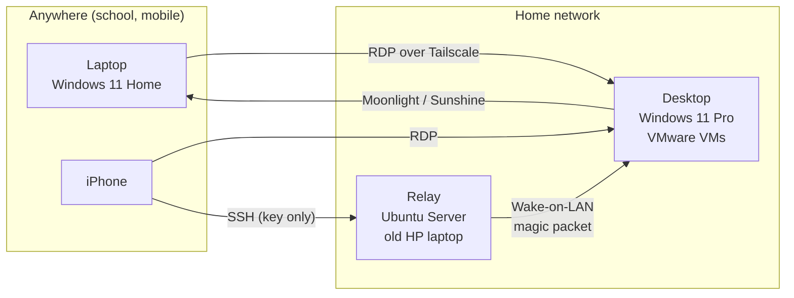

# Homelab

My personal homelab. I'm studying system and network administration, and I use this lab to practice what I learn, try things out on real hardware and document everything I build.

This repo documents the setup step by step, including the problems I ran into and how I fixed them.

## Current setup

| Device | OS | Role |
|---|---|---|
| Desktop | Windows 11 Pro | Main machine and VM host (VMware Workstation Pro). ASUS ROG Strix B550-F, Intel I225-V 2.5 GbE, NVMe SSD + 2 TB HDD for VMs |
| Laptop | Windows 11 Home | Mobile client, used at school |
| Relay | Ubuntu Server 26.04 LTS | Old HP laptop with a broken screen, runs headless. Always on, sends Wake-on-LAN packets |
| iPhone | iOS | Remote access (RDP, SSH) and one-tap Wake-on-LAN |

All devices are connected through a **Tailscale** mesh VPN, so they can reach each other from anywhere (home, school, mobile data) without opening any ports on the router.

## Parts

1. [Remote access](01-remote-access/README.md): Tailscale, RDP, Sunshine/Moonlight, moving VMs to the desktop over an SMB share
2. [Linux relay](02-linux-relay/README.md): Ubuntu Server on an old HP laptop with a broken screen, boot and network troubleshooting, key-only SSH
3. [Wake-on-LAN](03-wake-on-lan/README.md): waking the desktop from anywhere, including a one-tap iPhone Shortcut

## Lessons learned so far

- **Check the network layer before the application layer.** `tailscale ping` and `Test-NetConnection -Port` quickly showed whether a problem was networking, firewall or authentication.
- **Microsoft accounts and RDP/SMB don't mix well** when you only log in with a PIN. Windows needs a cached copy of the current password.
- **Old hardware has old firmware quirks.** The HP would not boot a GPT disk in legacy BIOS mode until the `pmbr_boot` flag was set.
- **netplan is strict.** YAML indentation errors and the networkd backend not supporting `match:` for Wi-Fi both cost me time.
- **Never sync VMs with OneDrive.** Large files, constant uploads and a real risk of corruption.

## Roadmap

- [ ] Proxmox on a spare PC as a dedicated hypervisor
- [ ] DNS filtering (AdGuard Home or Pi-hole)
- [ ] Monitoring (Uptime Kuma or Zabbix)
- [ ] Docker on the relay
- [ ] Self-hosted replacements for paid services (Nextcloud, Jellyfin, Vaultwarden)

> Note: passwords, keys, MAC addresses and IP addresses in this repo are placeholders.
